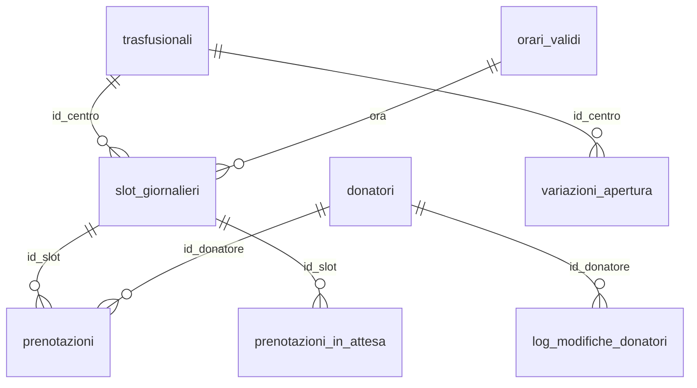

# Gedosan API

Backend REST per la gestione delle prenotazioni di donazione sangue presso i centri trasfusionali. Espone un flusso pubblico per i donatori (consultazione delle disponibilità e prenotazione con conferma via email, senza account) e un flusso amministrativo autenticato via JWT per la gestione di prenotazioni, donatori e orari di apertura.

## Indice

- [Stack tecnologico](#stack-tecnologico)
- [Architettura](#architettura)
- [Modello dati](#modello-dati)
- [Regole di business](#regole-di-business)
- [Avvio in locale](#avvio-in-locale)
- [Test](#test)
- [Endpoint API](#endpoint-api)
- [Esempi d'uso](#esempi-duso)
- [Sicurezza](#sicurezza)
- [Gestione degli errori](#gestione-degli-errori)
- [Deploy](#deploy)

## Stack tecnologico

| Componente | Tecnologia |
|---|---|
| Linguaggio | Java 21 |
| Framework | Spring Boot 4 |
| Persistenza | Spring Data JPA / Hibernate |
| Database | MySQL (8 in locale, 9.7 in produzione) |
| Migrazioni schema | Flyway |
| Sicurezza | Spring Security, JWT, Cloudflare Turnstile |
| Rate limiting | Bucket4j |
| Generazione PDF | OpenPDF |
| Invio email | Spring Mail (SMTP) |
| Test | JUnit 5, Testcontainers (MySQL 9.7) |

## Architettura

Struttura a livelli standard, package base `it.vszdev.gedosanapi`:

```
controller/   endpoint REST (pub/ per il donatore, admin/ protetti da JWT)
service/      logica di business, regole di dominio e job pianificati
repositories/ accesso ai dati (Spring Data JPA)
models/       entità JPA
dto/          oggetti di richiesta/risposta
security/     JWT, rate limiting, token di conferma, verifica Turnstile
validation/   validatori custom (codice fiscale e coerenza anagrafica)
exception/    eccezioni di dominio e gestione centralizzata degli errori
events/       invio email asincrono dopo il commit
config/       configurazione applicativa
```

Le regole di validazione delle prenotazioni (finestra temporale e anticipo minimo, età, intervallo tra donazioni, limite annuo per le donatrici, apertura del centro, disponibilità dello slot) sono centralizzate in `PrenotazioneService` e valgono per il donatore e per l'admin, con l'unica eccezione dell'anticipo minimo, non richiesto all'admin (che però non può prenotare uno slot già passato). Il "momento attuale" usa un `Clock` iniettabile su fuso `Europe/Rome`.

### Flusso di prenotazione

Il donatore non ha un account: l'identità si dimostra con il possesso dell'email. La richiesta crea solo un'attesa che tiene il posto per 30 minuti; donatore e prenotazione nascono quando il link ricevuto per email viene confermato.

```mermaid
sequenceDiagram
    participant D as Donatore
    participant API as Gedosan API
    participant DB as Database

    D->>API: POST /api/prenotazioni (dati + token Turnstile)
    API->>DB: blocca lo slot, crea l'attesa (token salvato come hash)
    API-->>D: 202, messaggio sempre uguale
    API--)D: email con il link di conferma (o avviso)
    D->>API: POST /api/prenotazioni/conferma (token)
    API->>DB: blocca attesa, donatore e slot; ricontrolla le regole
    API-->>D: 201 con i dati della prenotazione
    API--)D: email di conferma
```

Gli esiti che riguardano la persona (codice fiscale già registrato con un'altra email, email di un altro donatore, regole sulla storia delle donazioni) non compaiono nella risposta HTTP: arrivano per email all'indirizzo registrato. Così chi conosce i dati anagrafici di qualcuno non può scoprire se dona né quando. Un job elimina ogni minuto le attese scadute e restituisce i posti.

## Modello dati



| Tabella | Ruolo |
|---|---|
| `trasfusionali` | Centri di raccolta |
| `orari_validi` | Fasce orarie ammesse, comuni a tutti i centri |
| `slot_giornalieri` | Centro + orario + data, con `posti_occupati` (max 2, ricalcolato da prenotazioni confermate e attese non scadute), creato on-demand |
| `donatori` | Anagrafica, con `codice_fiscale` ed `email` univoci |
| `prenotazioni` | Prenotazioni confermate, uniche per `(id_donatore, id_slot)` |
| `prenotazioni_in_attesa` | Richieste in attesa di conferma: copia dei dati del modulo, hash del token, scadenza. Una sola per codice fiscale |
| `log_modifiche_prenotazioni` | Riprogrammazioni e cancellazioni fatte dagli admin |
| `log_modifiche_donatori` | Modifiche all'anagrafica fatte dagli admin (solo i nomi dei campi, non i valori) |
| `festivi_ricorrenti` | Festivi a data fissa, comuni a tutti i centri |
| `variazioni_apertura` | Chiusure o aperture straordinarie per centro e data |

## Regole di business

Parametrizzabili tramite `application.properties` (prefisso `prenotazioni.*`):

| Proprietà | Descrizione | Default |
|---|---|---|
| `orizzonte-giorni` | Giorni futuri massimi prenotabili | 365 |
| `anticipo-minimo-minuti` | Anticipo minimo tra prenotazione e inizio dello slot (solo donatore) | 90 |
| `eta-minima` / `eta-massima` | Età ammessa per prenotare online | 18 / 65 |
| `intervallo-uomini-giorni` | Intervallo minimo tra donazioni (uomini) | 90 |
| `distanza-minima-donne-giorni` | Intervallo minimo tra donazioni (donne) | 90 |
| `finestra-limite-donne-giorni` / `max-donazioni-donne-per-finestra` | Limite donazioni di una donatrice in una finestra mobile | 365 / 2 |
| `posti-per-slot` | Prenotazioni massime per slot orario (vincolato a `[1, 2]`, coerente col `CHECK` DB) | 2 |
| `minuti-attesa-conferma` | Validità del link di conferma; per tutto questo tempo la richiesta occupa il posto | 30 |

Altri vincoli applicati automaticamente:

- Non è ammesso prenotare una data uguale o anteriore a una prenotazione già presente (per anticiparla si riprogramma o si annulla).
- La riprogrammazione deve restare nello stesso centro trasfusionale.
- Il flusso pubblico non modifica mai l'anagrafica di un donatore esistente: i dati si cambiano solo dall'area admin, cioè dal centro.
- Una nuova richiesta dello stesso codice fiscale sostituisce l'attesa precedente.
- Il calendario mensile (`giorni-non-disponibili`) esclude anche i giorni in cui nessuno slot rispetta più l'anticipo minimo.

Il codice fiscale non è validato solo nella forma: viene decodificato (gestendo anche l'omocodia) e confrontato con cognome, nome, data di nascita e sesso dichiarati, rifiutando la richiesta se non combaciano. Nome e cognome sono normalizzati (spazi) e ammettono solo lettere, spazi, apostrofi, punti e trattini. Le stesse regole valgono per la modifica dell'anagrafica dall'area admin.

## Avvio in locale

Richiede Java 21+ e Docker.

```bash
docker compose up -d          # avvia un MySQL vuoto
./mvnw spring-boot:run        # Flyway applica schema e dati demo
```

L'API risponde su `http://localhost:8080`. I default in `application.properties` combaciano con `docker-compose.yml`; servono solo `MAIL_USERNAME`, `MAIL_PASSWORD` e `JWT_SECRET` (base64, almeno 256 bit). In locale Turnstile è disattivato e il link di conferma punta a `http://localhost:4200`.

Per provare l'invio delle email senza un SMTP vero si può usare un server di test come Mailpit e avviare con `--spring.mail.host=localhost --spring.mail.port=1025`.

Flyway è attivo anche in produzione, ma applica solo lo schema (`db/migration`, niente dati demo). Il DB di produzione è nato prima di Flyway con V1 e V2 applicate a mano: `baseline-version=2` lo registra a quel punto e le migrazioni successive partono da sole al deploy.

### Credenziali demo

| Username | Password |
|---|---|
| `demo` | `demo1234` |

## Test

```bash
./mvnw test     # richiede Docker avviato
```

I test di integrazione girano su MySQL 9.7 in container (Testcontainers), con le migrazioni Flyway e i dati demo. Coprono il flusso di richiesta e conferma, i casi di sicurezza (codice fiscale registrato con un'altra email, email di un altro donatore, regole comunicate solo via email), la scadenza delle attese, gli endpoint admin dei donatori e la concorrenza reale: doppio click sullo stesso link e due richieste contemporanee sull'ultimo posto.

Proprio un test di concorrenza ha mostrato che con il `REPEATABLE READ` di default di MySQL i conteggi fatti dopo i lock pessimistici leggevano dati precedenti al lock, e due richieste sull'ultimo posto passavano entrambe. Per questo il pool di connessioni usa `READ COMMITTED`.

## Endpoint API

### Pubblico (nessuna autenticazione)

| Metodo | Endpoint | Descrizione |
|---|---|---|
| `GET` | `/api/trasfusionali` | Elenco centri |
| `GET` | `/api/trasfusionali/{id}/giorni-non-disponibili?mese=YYYY-MM` | Giorni non prenotabili del mese (chiusure e giorni senza slot entro l'anticipo) |
| `GET` | `/api/trasfusionali/{id}/slot?data=YYYY-MM-DD` | Slot disponibili in una data |
| `POST` | `/api/prenotazioni` | Richiesta di prenotazione: crea un'attesa e invia il link (202) |
| `POST` | `/api/prenotazioni/conferma` | Conferma con il token del link (201) |

### Amministrativo (richiede `Authorization: Bearer <token>`)

| Metodo | Endpoint | Descrizione |
|---|---|---|
| `POST` | `/api/auth/login` | Login, restituisce un token JWT |
| `GET` | `/api/admin/prenotazioni?idTrasfusionale=&data=` | Elenco prenotazioni |
| `POST` | `/api/admin/prenotazioni` | Creazione diretta (senza conferma via email) |
| `PATCH` | `/api/admin/prenotazioni/{id}` | Riprogrammazione su un nuovo slot |
| `DELETE` | `/api/admin/prenotazioni/{id}` | Cancellazione |
| `GET` | `/api/admin/prenotazioni/esportazione?...` | Esportazione PDF delle prenotazioni del giorno |
| `GET` | `/api/admin/donatori?q=` | Ricerca donatori per email o codice fiscale esatti, oppure per prefisso del cognome (max 50) |
| `GET` | `/api/admin/donatori/{id}` | Anagrafica, storico prenotazioni e modifiche |
| `PATCH` | `/api/admin/donatori/{id}` | Modifica dell'anagrafica completa, con verifica di coerenza del codice fiscale |
| `GET`/`POST`/`DELETE` | `/api/admin/variazioni-apertura` | Gestione aperture/chiusure straordinarie |
| `GET` | `/api/admin/giorni-chiusura?idTrasfusionale=&anno=` | Giorni di chiusura di un centro per anno (festivi ordinari + straordinarie; anno corrente o successivi) |
| `GET` | `/api/admin/log-modifiche` | Storico modifiche alle prenotazioni effettuate dagli admin |

## Esempi d'uso

```bash
# Slot disponibili
curl "http://localhost:8080/api/trasfusionali/1/slot?data=2026-11-17"

# Richiesta di prenotazione
curl -X POST http://localhost:8080/api/prenotazioni \
  -H "Content-Type: application/json" \
  -d '{
    "nome": "Mario", "cognome": "Rossi",
    "dataNascita": "1990-05-12", "sesso": "M",
    "codiceFiscale": "RSSMRA90E12H501K",
    "email": "mario.rossi@example.com",
    "cellulare": "+393401234567",
    "idSlot": 12, "tipoDonazione": "SI",
    "turnstileToken": "<token del widget>"
  }'
# 202 {"messaggio": "Se i dati sono corretti riceverai a breve un'email ..."}

# Conferma con il token ricevuto nel link
curl -X POST http://localhost:8080/api/prenotazioni/conferma \
  -H "Content-Type: application/json" \
  -d '{ "token": "<token dal link>" }'
```

La risposta della conferma contiene anche indirizzo, civico e telefono del centro, così il donatore ha tutti i dati anche se l'email finale non arriva.

```bash
# Login admin (utente demo)
TOKEN=$(curl -s -X POST http://localhost:8080/api/auth/login \
  -H "Content-Type: application/json" \
  -d '{ "username": "demo", "password": "demo1234" }' | jq -r .token)

# Ricerca di un donatore
curl "http://localhost:8080/api/admin/donatori?q=rossi" -H "Authorization: Bearer $TOKEN"
```

## Sicurezza

### Identità del donatore

Nel sistema reale a cui si ispira il progetto i donatori sono già registrati in un'anagrafica verificata di persona. Qui non c'è un'anagrafica esterna e il codice fiscale non è un segreto (si ricava dai dati anagrafici), quindi l'identità si dimostra con il possesso dell'email:

- la richiesta crea un'attesa e il link di conferma arriva all'email; per un codice fiscale già registrato con un'email diversa la richiesta non viene accettata e l'avviso va all'email registrata;
- il token del link è casuale a 256 bit, monouso, scade in 30 minuti e a database è salvato solo come hash SHA-256;
- la conferma avviene con una `POST` dalla pagina del frontend, mai aprendo il link: client di posta e antivirus aprono da soli i link delle email;
- la risposta pubblica è sempre la stessa, i dettagli personali arrivano solo via email;
- l'anagrafica di un donatore esistente si modifica solo dall'area admin, con audit dei campi modificati.

In produzione l'identità arriverebbe da SPID/CIE o dall'anagrafica regionale dei donatori.

### Altre misure

- Autenticazione JWT (HMAC) per gli endpoint amministrativi, applicazione stateless (nessuna sessione HTTP).
- Password admin hashate con BCrypt.
- Cloudflare Turnstile sulla richiesta pubblica, verificato lato server e fail-closed (se Cloudflare non risponde la richiesta è rifiutata).
- CORS configurabile tramite `cors.allowed-origins`.
- Rate limiting (Bucket4j) per indirizzo IP, con supporto all'header `CF-Connecting-IP` dietro proxy/CDN: login e richiesta di prenotazione (5/minuto), conferma (10/minuto), consultazione pubblica dei centri (60/minuto).
- Lock pessimistici in ordine fisso (attesa → donatore → slot, slot per id crescente) e isolamento `READ COMMITTED`: niente overbooking né doppie conferme sotto concorrenza.
- Nei log nessun dato personale dei donatori.

## Gestione degli errori

Formato JSON uniforme per ogni errore:

```json
{
  "status": 409,
  "errore": "Prenotazione non consentita",
  "messaggio": "Lo slot selezionato non è più disponibile.",
  "path": "/api/prenotazioni"
}
```

| Stato | Caso |
|---|---|
| `400` | Validazione fallita (campo per campo), parametro non valido, verifica anti-bot non superata |
| `401` | Login fallito |
| `403` | Endpoint admin senza token valido |
| `404` | Risorsa non trovata, link di conferma non valido, già usato o scaduto |
| `409` | Regola non rispettata: sulla richiesta pubblica solo quelle che non dipendono dalla persona (slot pieno, centro chiuso, fuori orizzonte, anticipo, età); sulla conferma e nell'area admin anche quelle sulla storia del donatore. Vincolo del database violato |
| `429` | Rate limit superato |
| `500` | Errore interno |

## Deploy

Il deploy parte da GitHub Actions (runner self-hosted) a ogni push su `main`. Variabili d'ambiente richieste in produzione, tutte da GitHub Secrets: `DB_USERNAME`, `DB_PASSWORD`, `MAIL_USERNAME`, `MAIL_PASSWORD`, `JWT_SECRET`, `CORS_ALLOWED_ORIGINS`, `TURNSTILE_SECRET`. Facoltativa `FRONTEND_URL` (default `https://gedosan.vszdev.it`).

### Primo deploy con conferma via email (migrazioni V3 e V4)

1. **Secret:** aggiungere `TURNSTILE_SECRET` (Secret Key del widget Cloudflare il cui hostname è `gedosan.vszdev.it`; la Site Key dello stesso widget è nel frontend).
2. **Backup** del database sul server:
   ```bash
   docker exec gedosan-db sh -c 'exec mysqldump --single-transaction --routines --triggers --events \
     --set-gtid-purged=OFF --no-tablespaces -uroot -p"$MYSQL_ROOT_PASSWORD" donazioni_db' \
     | gzip > backup_gedosan_$(date +%F).sql.gz
   ```
3. **Permessi:** l'utente `DB_USERNAME` deve poter creare tabelle, indici e chiavi esterne (`CREATE`, `ALTER`, `INDEX`, `REFERENCES`), altrimenti Flyway fallisce all'avvio.
4. **Deploy del backend:** al primo avvio Flyway crea `flyway_schema_history`, registra la baseline 2 e applica V3 e V4. Controllo:
   ```sql
   SELECT version, description, success FROM flyway_schema_history ORDER BY installed_rank;
   ```
5. **Deploy del frontend** subito dopo: la richiesta pubblica ora risponde 202, richiede il token Turnstile e il link porta alla pagina `/conferma`. Con il frontend vecchio le prenotazioni pubbliche non funzionano.
6. **Prova completa:** prenotazione dal sito, email ricevuta, conferma, prenotazione visibile nell'area admin.

**Ritorno indietro:** ripristinare il commit precedente di backend e frontend. Le tabelle nuove non danno fastidio alla versione precedente; in caso di problemi allo schema si ripristina il backup.

## Licenza

© 2026 vszdev. Codice sorgente reso pubblico a scopo dimostrativo e di consultazione.
